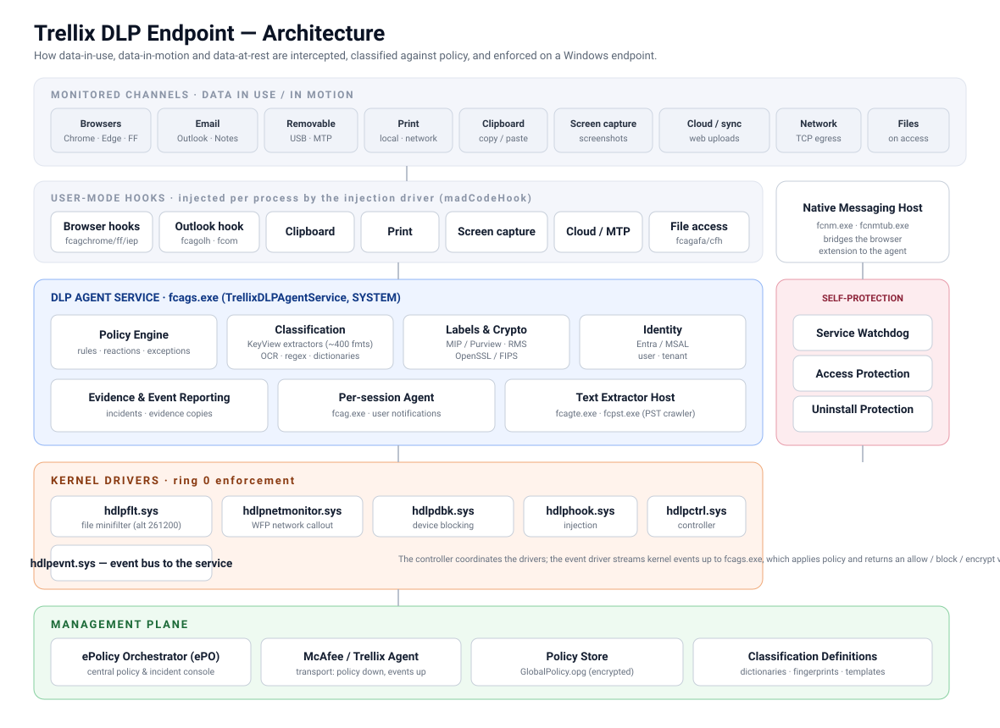
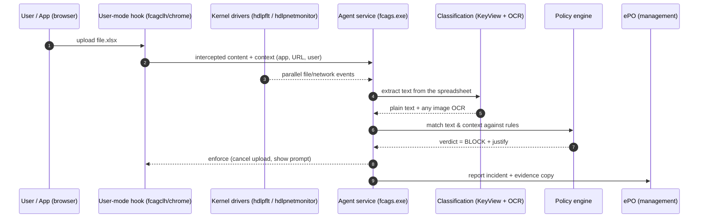

<div align="center">

# 🛡️ Trellix DLP Endpoint

### How every component of Trellix (McAfee) Data Loss Prevention actually works

*A component-by-component teardown of a live Trellix DLP Endpoint install, with a professional architecture reference and a small read-only inspection tool.*


</div>

---

## Table of contents

- [What Trellix DLP is](#what-trellix-dlp-is)
- [The architecture at a glance](#the-architecture-at-a-glance)
- [How a single action is evaluated](#how-a-single-action-is-evaluated)
- [Component reference](#component-reference)
  - [1 · Kernel drivers (ring 0)](#1--kernel-drivers-ring-0)
  - [2 · The agent service & processes](#2--the-agent-service--processes)
  - [3 · User-mode hooks](#3--user-mode-hooks)
  - [4 · Content classification: KeyView + OCR](#4--content-classification-keyview--ocr)
  - [5 · Labels, encryption & identity](#5--labels-encryption--identity)
  - [6 · Browser integration](#6--browser-integration)
  - [7 · Email integration](#7--email-integration)
  - [8 · Self-protection](#8--self-protection)
  - [9 · Management plane (ePO)](#9--management-plane-epo)
- [Where everything lives on disk](#where-everything-lives-on-disk)
- [The `dlpdump` tool](#the-dlpdump-tool)
- [Evidence & method](#evidence--method)
- [Disclaimer](#disclaimer)

---

## What Trellix DLP is

**Trellix DLP Endpoint** (formerly **McAfee DLP Endpoint**) is a host agent that stops
sensitive data from leaving a Windows machine. It does three jobs at once:

| | | |
|---|---|---|
| 📤 **Data in motion** | Watches the ways data *leaves*: web uploads, email, USB, print, clipboard, screenshots, network. | *egress control* |
| 💻 **Data in use** | Sees content *while you work with it*, inside browsers and Office apps, before it is encrypted or sent. | *in-context control* |
| 💾 **Data at rest** | Scans files and mailboxes already on the disk to find and remediate sensitive content. | *discovery* |

Every action a user takes is checked against a **policy** (a set of rules + reactions)
pushed from a central server. The agent decides in real time to **allow**, **block**,
**encrypt**, **request justification**, or **log + copy evidence**.

The product is deliberately layered: **kernel drivers** do low-level interception,
**user-mode hooks** see content in context, a **service** holds the brains (policy +
classification), and a **management plane** distributes policy and collects incidents.

---

## The architecture at a glance

<div align="center">
  
</div>

> The layers, top to bottom: the **channels** being watched → **user-mode hooks** injected
> into applications → the **agent service** with its policy, classification, crypto and
> identity engines → the **kernel drivers** that enforce in ring 0 → the **management
> plane** that feeds policy in and takes incidents out. A full written walkthrough is in
> [`docs/ARCHITECTURE.md`](docs/ARCHITECTURE.md).

---

## How a single action is evaluated

Take one concrete example — *a user drags a spreadsheet into a webmail upload*:



The key idea: **classification happens in user mode where the data is still plaintext**,
while **enforcement is backed by kernel drivers** that the application cannot bypass.

---

## Component reference

> Every file below is Authenticode-signed by **Musarubra US LLC** (Trellix's signing
> entity). Descriptions are taken from each binary's own version resource and the agent's
> runtime log. Sizes are from the analyzed 11.14 build.

### 1 · Kernel drivers (ring 0)

The enforcement floor. Six drivers, loaded as Windows services, that an application
cannot go around.

| Driver | Role | Mechanism |
|---|---|---|
| **`hdlpflt.sys`** | Mini File Filter | File-system **minifilter** at altitude **261200** (group *FSFilter Content Screener*) — sees every file open/read/write for on-access scanning and file encryption. Boot-start. |
| **`hdlpnetmonitor.sys`** | Network Callout | **Windows Filtering Platform** callout — inspects outbound network/TCP flows for network DLP. |
| **`hdlpdbk.sys`** | Device Blocking | Controls removable storage and device classes (USB mass storage, MTP phones, Bluetooth, etc.). |
| **`hdlphook.sys`** | Injection Driver | Loads the user-mode hook DLLs into target processes (built on the **madCodeHook** framework). |
| **`hdlpctrl.sys`** | Controller | Coordinates the other drivers and bridges them to the service. |
| **`hdlpevnt.sys`** | Event Manager | Streams kernel-side events up to `fcags.exe`. |

> 💡 **Why a minifilter?** It gives the agent a guaranteed, in-kernel seat on every file
> operation — the one place a user-mode app cannot avoid — so policy can be enforced even
> if the hooks are evaded.

### 2 · The agent service & processes

| Executable | Description | Size |
|---|---|---|
| **`fcags.exe`** | **DLP Endpoint Service** — the core process (`TrellixDLPAgentService`, runs as SYSTEM). Holds the policy engine, classification pipeline and event reporting. | 21 MB |
| **`fcag.exe`** | **Endpoint Agent** — per-session host that enforces in the user's context and shows notifications/justification prompts. | 19 MB |
| **`fcagswd.exe`** | **Service WatchDog** — restarts the agent if it is killed. | 6 MB |
| **`fcagte.exe`** | **Text Extractor** — hosts the KeyView/OCR extraction pipeline out-of-process. | 10 MB |
| **`fcpst.exe`** | **Email Storage Crawler** — scans PST/OST mailbox stores (data-at-rest discovery). | 16 MB |
| **`fcom.exe`** | **Outlook Monitor** — email send-time inspection. | 10 MB |
| **`fcnm.exe` / `fcnmtub.exe`** | **Native Messaging Host** — bridges the browser extensions to the agent over stdio. | 7–8 MB |
| **`fcpm.exe`** | **Performance Monitor** — agent self-telemetry. | 7 MB |
| **`fcagd.exe`** | **Diagnostics**. | 7 MB |
| **`Tools\hdlpDiag.exe`** | Vendor diagnostic collector. | 12 MB |

### 3 · User-mode hooks

Injected into applications by `hdlphook.sys` to see content **in context**, while it is
still plaintext. They ship as 32- and 64-bit pairs.

| Hook | Watches |
|---|---|
| `fcagcbh*` | **Clipboard** (copy/paste of sensitive data) |
| `fcagpph*` | **Printing** (local & network) |
| `fcagsch*` | **Screen capture** (screenshots / screen share) |
| `fcagcfh*` | **Copy-to / Save-as file** operations |
| `fcagclh*` | **Cloud** application uploads |
| `fcagmtph*` | **MTP** devices (phones, cameras, media players) |
| `fcagafa*` | **Application file access** |
| `fcagchrome*`, `fcagff*`, `fcagiep*`, `fcplie*` | **Browsers** (Chrome, Firefox, IE/Edge) |
| `fcagolh*` | **Outlook** |

### 4 · Content classification: KeyView + OCR

How the agent *reads* content so it can be matched against rules.

- **~194 KeyView filters** (`*sr.dll`, `kp*rdr.dll`, `kv*.dll`) — OpenText KeyView, the
  same engine used by e-discovery products, crack open **~400 file formats** (Office,
  PDF, archives, PST/NSF mail stores, CAD, images…) to extract their text. Examples:
  `pdfsr.dll`, `xlsxsr.dll`, `pstsr.dll`, `nsfsr.dll`, `htmlsr.dll`.
- **`ocr.dll`** (12 MB, OpenText IDOL OCR) — pulls text out of **images** so a secret in a
  screenshot or scanned document is still caught.
- **`langdetectext.dll`**, `icu*` — language detection and Unicode handling.

Extracted text is then matched against the policy's **classifications**: keywords and
dictionaries, regular expressions, document fingerprints, and sensitivity labels.

### 5 · Labels, encryption & identity

| Component | Purpose |
|---|---|
| `mip_*.dll` (core, file, protection, upe SDKs) | **Microsoft Information Protection / Purview** — read and honour sensitivity labels and open RMS-protected content. |
| `TitusSDKInterface.dll` | Titus/Fortra classification label integration. |
| `cryptographyservices.dll`, `libcrypto-3-x64.dll`, `fips.dll` | OpenSSL / FIPS crypto for on-the-fly **encryption** reactions and secure comms. |
| `msalruntime.dll`, `Microsoft.Identity.Client*`, `AzureAuthentication.dll`, `EntraIdBridge.dll` | **Entra ID / MSAL** — resolve the signed-in user and tenant for identity-aware policy and cloud auth. |

### 6 · Browser integration

A three-part chain, because browsers sandbox their content:

```
Browser extension  ──stdio──►  Native Messaging Host  ──IPC──►  Agent service
(in Chrome/Edge)                (fcnm.exe / fcnmtub.exe)         (fcags.exe)
```

- The extensions are registered via `native_messaging_*_manifest.json`, which whitelist
  the Chrome extension IDs `cokbpgemipiebgbmnnlfboefilmdlonm` and
  `obnpejeijhoakobhmcdlmfdnanpgopkn`.
- In parallel, in-process hooks (`fcagchrome*`, `fcagff*`, `fcagiep*`) and the network
  callout driver provide defense in depth, so uploads are caught even without the
  extension.

### 7 · Email integration

- **`fcom.exe` + `fcagolh*`** inspect Outlook messages at send time.
- **`outlook_monitor.bundle`** is a modern Outlook **web add-in** — it even ships a local
  TLS cert (`localhost.pem`) so the add-in can talk to a loopback HTTPS endpoint.
- **`NSFtemplates/`** holds HTML notification templates for **IBM/HCL Notes** mail.
- **`fcpst.exe`** crawls PST/OST archives at rest.

### 8 · Self-protection

Because a security control is only as good as its resistance to being switched off:

- **`UninstallProtection.exe`** — blocks unauthorized removal.
- **`fcagswd.exe`** + a per-session `AgentWatchDog` thread — restart the agent if killed.
- **Access Protection** — the service registers kernel-backed protection of its own
  files, services and registry (`AccessProtectionObject OK!` in the log).
- The **policy store is ACL-locked** — even listing it is denied to a normal user.

### 9 · Management plane (ePO)

The agent is normally **centrally managed** by **ePolicy Orchestrator (ePO)**:

| Piece | Role |
|---|---|
| **ePO server** | Central console: authors policy, receives incidents & evidence. |
| **McAfee/Trellix Agent** (`masvc`/`macmnsvc`) | Transport: pulls policy down, pushes events up. |
| **Policy store** | `GlobalPolicy.opg` — the encrypted compiled policy the agent enforces. |
| **Classification definitions** | Dictionaries, fingerprints, templates referenced by rules. |

Without ePO the agent runs **standalone** and simply enforces whatever policy is cached
locally — on the analyzed machine there was no server configured, so it idled with no
active policy (clearly visible in the logs).

---

## Where everything lives on disk

```
C:\Program Files\McAfee\DLP\Agent\        ← program files
  fcag*.exe                               core service & helper processes
  hdlp*.sys                               six kernel drivers
  fcag{cbh,pph,sch,...}{32,64}.dll        user-mode hooks (32/64-bit)
  *sr.dll  kp*rdr.dll  kv*.dll            ~194 KeyView format filters
  ocr.dll                                 OCR engine
  mip_*.dll  cryptographyservices.dll     labels / RMS / crypto
  *.Identity.* msalruntime.dll            Entra / MSAL identity
  native_messaging_*_manifest.json        browser bridge manifests
  outlook_monitor.bundle\  NSFtemplates\  email add-in & templates
  Tools\                                  hdlpDiag.exe, DlpConsoleRunner.exe
  x86\                                    32-bit support copies

C:\ProgramData\McAfee\DLP\                ← runtime state
  Agent\Policy\                           policy store (ACL-locked)
  Agent\IncrementalData\                  incremental policy/classification data
  Temp\Logs\AgentService\                 HDLP_Service_*.log  (health & startup)

HKLM\SOFTWARE\McAfee\DLP\Agent            ← configuration & management state
```

---

## The `dlpdump` tool

A small, **strictly read-only** inspector that dumps the live deployment — exactly the
evidence this guide is built from. It changes nothing: it never starts, stops, disables
or reconfigures the agent.

```bash
cd dlpdump
go build -o dlpdump.exe .

dlpdump                 # full report (text)
dlpdump --format md     # Markdown component catalog (the tables above, from YOUR machine)
dlpdump --format json   # machine-readable
dlpdump --deep          # verify the Authenticode signature of every module
```

It reports: the component inventory grouped by subsystem with signature verification,
the live state of the services and six kernel drivers, the management/policy state, and a
health summary parsed from the agent's own log. See [`dlpdump/README.md`](dlpdump/README.md).

---

## Evidence & method

Everything here was established by **read-only observation** of a live install:
directory + PE version-resource enumeration, Authenticode verification, the Service
Control Manager, the `HKLM\SOFTWARE\McAfee\DLP` registry, and the agent's own log under
`C:\ProgramData\McAfee\DLP`. No binary was modified, no protected policy content was read,
and nothing in the agent's enforcement was touched. Claims are separated into **observed**
(read directly), **inferred** (reasoned from observation) and **unknown** in
[`docs/ARCHITECTURE.md`](docs/ARCHITECTURE.md).

Analyzed build: **Trellix DLP Endpoint 11.14.0.4142**, Windows 11.

## Disclaimer

This is an **independent, educational** reference for administrators and researchers who
run Trellix DLP and want to understand what it installs and how the pieces fit. It is not
affiliated with or endorsed by Trellix/Musarubra. All product names and trademarks belong
to their owners. Nothing here is a guide to disabling, bypassing or tampering with the
product — the tooling is read-only by design.
