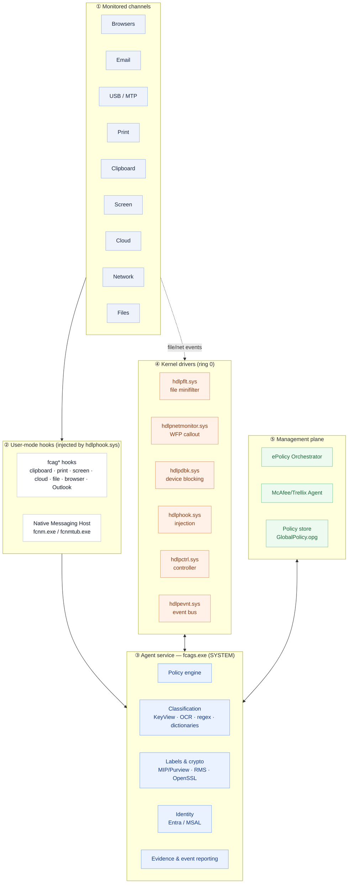
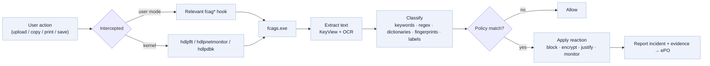
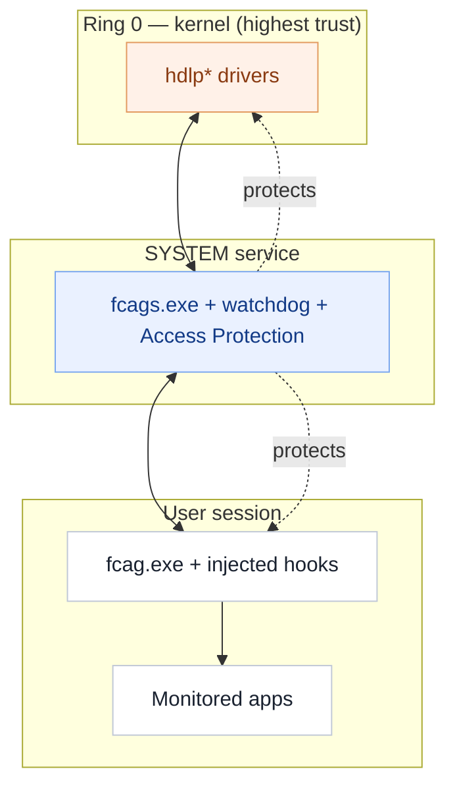
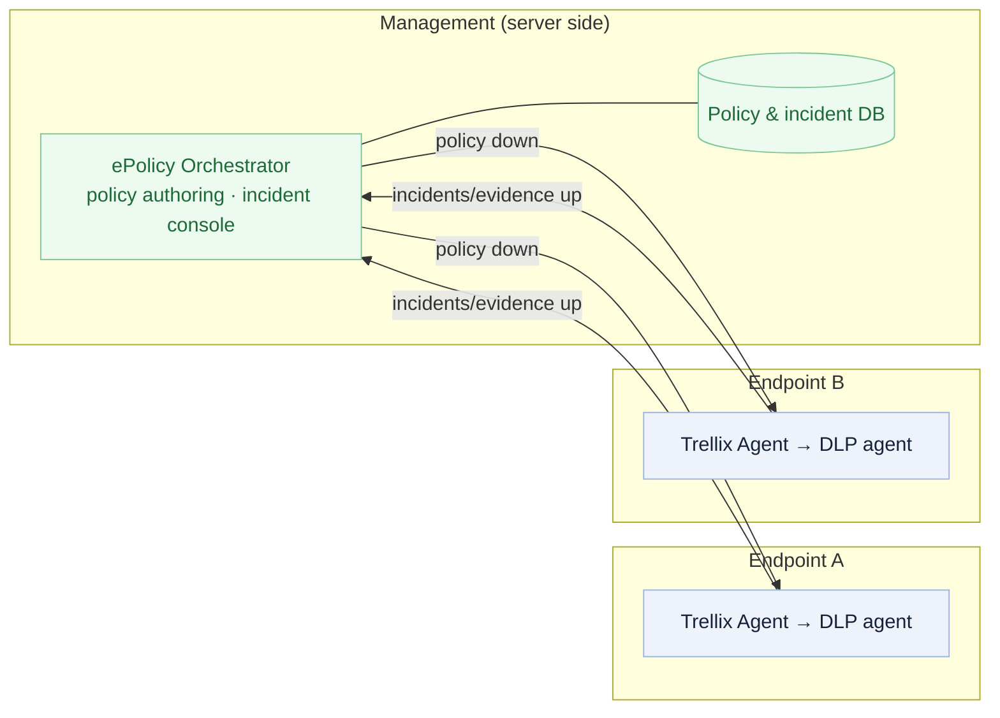

# Trellix DLP Endpoint — Architecture Reference

A professional architecture description of Trellix (McAfee) DLP Endpoint, derived from a
read-only teardown of a live **11.14.0.4142** install on Windows 11. The companion
[`README.md`](../README.md) is the component field guide; this document is the design
reference: layers, data flows, trust boundaries, and deployment topology.

Each statement is tagged **[observed]** (read directly from the binaries, registry, SCM
or logs), **[inferred]** (reasoned from observations), or **[unknown]** (not established
by read-only means).

---

## 1. Design principles

Three principles explain almost every component:

1. **Intercept where the data is readable.** Content is classified in **user mode**,
   inside the application, where it is still plaintext — before TLS, before archiving,
   before the clipboard is consumed. *[inferred from the hook set + KeyView placement]*
2. **Enforce where the application cannot escape.** The hard guarantees live in **kernel
   drivers** (file minifilter, network callout, device blocking) that an app cannot go
   around. *[observed: six `hdlp*.sys` drivers]*
3. **Separate brain from hands.** One **service** (`fcags.exe`) holds policy and
   classification; thin **hooks**, **drivers** and **per-session agents** do the
   intercepting and enforcing and report back. *[observed: service + driver + hook split]*

---

## 2. Layered model

A rendered, print-quality version is [`architecture.svg`](architecture.svg).

---

## 3. The layers in detail

### ① Monitored channels *[observed]*
The egress and in-use channels the product cares about: browsers, Outlook/Notes email,
removable storage and MTP devices, local/network printing, clipboard, screen capture,
cloud/web uploads, raw network, and files on access.

### ② User-mode hooks *[observed set; [inferred] mechanism]*
`hdlphook.sys` injects the `fcag*` hook DLLs (shipped as 32- and 64-bit pairs) into
running processes. Each hook understands one channel (see the README's hook table). The
service log line `Madshi driver installed.` indicates the injection is built on the
**madCodeHook** library. The browser extensions reach the agent through the **Native
Messaging Host** (`fcnm.exe`/`fcnmtub.exe`) over Chrome native-messaging stdio.

### ③ Agent service *[observed process; [inferred] internal split]*
`fcags.exe` runs as the SYSTEM service `TrellixDLPAgentService`. It contains:

- **Policy engine** — evaluates rules, reactions and exceptions against each event.
- **Classification** — drives KeyView extraction and OCR (hosted out-of-process by
  `fcagte.exe`) and applies keyword/dictionary/regex/fingerprint matching.
- **Labels & crypto** — MIP/Purview sensitivity labels, RMS decryption, OpenSSL/FIPS for
  encryption reactions.
- **Identity** — Entra/MSAL user and tenant resolution.
- **Evidence & event reporting** — builds incidents and evidence copies for the console.

`fcag.exe` is the per-session arm that enforces in the user's desktop context and shows
justification/notification prompts.

### ④ Kernel drivers *[observed]*
See the README table. Load characteristics confirmed from the registry:

| Driver | Start | Type | Group / Altitude |
|---|---|---|---|
| `hdlpflt` | boot (1) | file system (2) | *FSFilter Content Screener*, altitude **261200** |
| `hdlpdbk` | demand (3) | kernel (1) | device blocking |
| `hdlpnetmonitor` | demand (3) | kernel (1) | WFP callout |
| `hdlphook` | demand (3) | kernel (1) | injection |
| `hdlpctrl` | demand (3) | kernel (1) | controller |
| `hdlpevnt` | demand (3) | kernel (1) | event bus |

### ⑤ Management plane *[observed standalone; [inferred] managed]*
Normally ePO authors and pushes policy and collects incidents through the McAfee/Trellix
Agent transport. The compiled policy is cached as `GlobalPolicy.opg`. On the analyzed
host there was **no ePO server configured** (`AgentOnline=0`, no `AgentGUID`), so the
agent idled with no active policy — visible as repeating
`ePO connection information is missing` warnings in the log.

---

## 4. Decision data flow

**[inferred]** overall; each node is **[observed]** as a present capability (hooks,
drivers, KeyView, classification data, reaction types, evidence reporting), but the exact
ordering inside `fcags.exe` is not visible from read-only inspection.

---

## 5. Trust boundaries & self-protection

**[observed]** Self-protection spans all three rings: `UninstallProtection.exe`, the
`fcagswd.exe` watchdog + per-session `AgentWatchDog`, kernel-backed **Access Protection**
of the agent's files/services/registry, and an **ACL-locked policy store** that a normal
user cannot even list. **[inferred]** The intent is that neither a standard user nor a
compromised application can silently disable the agent or read/alter its policy.

---

## 6. Deployment topology

**[inferred]** from the management-plane components and the agent's ePO connectivity
state machine; the server side was not present on the analyzed host.

---

## 7. What is *not* established (read-only limits)

- **[unknown]** The internal format of `GlobalPolicy.opg` and `IncrementalData` (the
  policy store is encrypted and ACL-locked; it was not opened).
- **[unknown]** The exact driver↔service control protocol and hook↔service IPC.
- **[unknown]** The precise evaluation order and threading inside `fcags.exe`.
- **[unknown]** Which classification/telemetry paths make outbound network calls, and
  behaviour that only appears under active ePO management or with a deployed policy.

These would require dynamic analysis or vendor documentation and were intentionally left
untouched to keep this a read-only study.

---

## 8. Component → responsibility map (quick index)

| Layer | Files | Responsibility |
|---|---|---|
| Kernel | `hdlpflt/dbk/netmonitor/hook/ctrl/evnt.sys` | Interception & enforcement in ring 0 |
| Service | `fcags.exe`, `fcag.exe`, `fcagswd.exe` | Policy, classification, enforcement, self-protection |
| Extraction | `fcagte.exe`, `*sr.dll`, `kp*rdr.dll`, `ocr.dll` | Turn any file/image into text |
| Hooks | `fcag*{32,64}.dll` | See content in-app across every channel |
| Email | `fcom.exe`, `fcagolh*`, `fcpst.exe`, `outlook_monitor.bundle`, `NSFtemplates` | Outlook/Notes inspection & PST discovery |
| Browser | `fcnm.exe`, `fcnmtub.exe`, extensions, `fcagchrome/ff/iep*` | Browser upload inspection |
| Labels/crypto | `mip_*.dll`, `TitusSDKInterface.dll`, `cryptographyservices.dll`, `fips.dll` | Sensitivity labels, RMS, encryption |
| Identity | `msalruntime.dll`, `Microsoft.Identity.*`, `EntraIdBridge.dll` | User/tenant resolution |
| Management | ePO, Trellix Agent, `GlobalPolicy.opg` | Policy distribution & incident collection |
