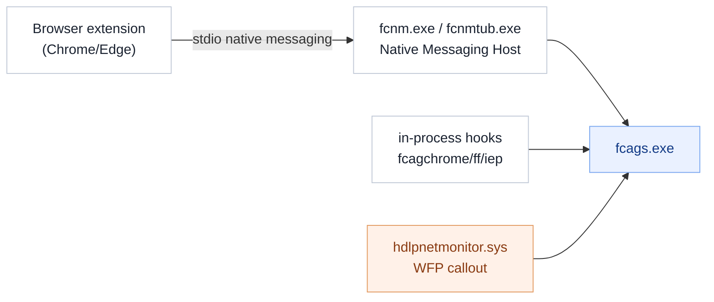

# Browser integration, up close

Browsers are a top egress channel (webmail, uploads, paste-into-web-app), and they
sandbox their content, so DLP reaches them three ways at once. A **read-only static**
teardown, companion to [`HOOKS.md`](HOOKS.md).

*Method: the native-messaging manifests, file inventory and version resources. Nothing run
or modified.*

## The chain



## 1. Extension + Native Messaging Host

**[observed]** `native_messaging_tub_manifest.json` and `native_messaging_tum_manifest.json`
register a native-messaging host `com.trellix.dlp_native_messaging_host` over **stdio**,
pointing at `fcnmtub.exe` / `fcnm.exe`, and whitelist two Chrome extension IDs:

```
chrome-extension://obnpejeijhoakobhmcdlmfdnanpgopkn/
chrome-extension://cokbpgemipiebgbmnnlfboefilmdlonm/
```

**[inferred]** The extension observes page/upload events in the browser and relays them to
the agent through the host; `allowed_origins` restricts which extensions may connect.

## 2. In-process hooks

**[observed]** `fcagchrome/chrome64`, `fcagff/ff64`, `fcagiep32/64`, `fcplie32/64` (see
[`HOOKS.md`](HOOKS.md)). **[inferred]** They catch content inside the browser process even
where the extension cannot.

## 3. Network backstop

**[observed]** `hdlpnetmonitor.sys` (WFP callout, see [`DRIVERS.md`](DRIVERS.md)).
**[inferred]** Catches the actual outbound flow regardless of browser, so an upload is
seen even if extension and hooks are bypassed.

## Why three layers

**[inferred]** Defense in depth across different trust/visibility levels: the extension
has the richest page context but is the easiest to disable; the hooks are harder to avoid;
the network callout is the guaranteed floor.

## Not established

- **[unknown]** The native-messaging message schema and how strictly origin/extension
  identity is enforced beyond the manifest allow-list.
