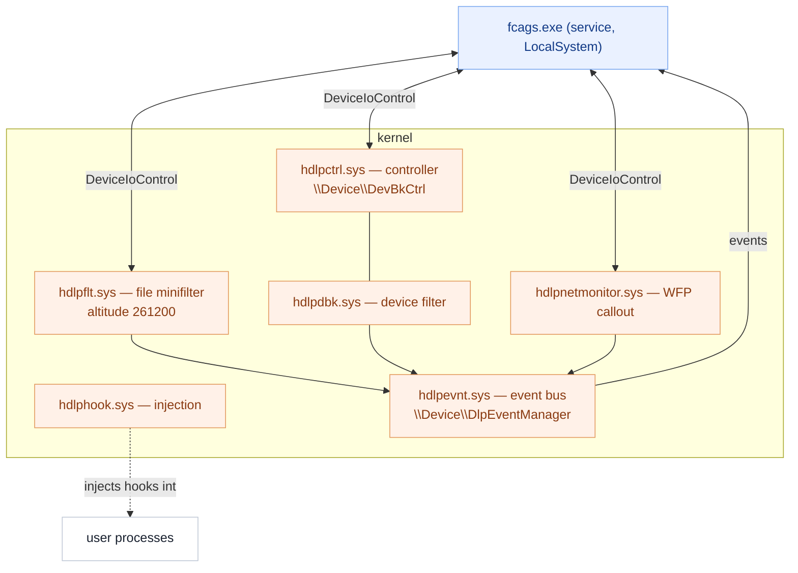

# The kernel drivers, up close

Trellix DLP Endpoint ships six signed kernel-mode drivers (`hdlp*.sys`). They are the
enforcement floor of the product: the places a user-mode application cannot go around.
This note is a focused, **read-only static** teardown of what each one is and how they fit
together, companion to [`FCAGS.md`](FCAGS.md) (the service that drives them).

*Method: PE import tables, embedded device/altitude strings, driver registration, and the
agent's own log. Nothing was loaded under analysis or modified. All six are Authenticode-
signed by **Musarubra US LLC**.*

## The stack at a glance

The pattern **[inferred]**: sensors (`hdlpflt`, `hdlpnetmonitor`, `hdlpdbk`) detect
activity and raise events through `hdlpevnt` to the service; the service pushes
configuration/verdicts back down via `DeviceIoControl` on the device objects; `hdlpctrl`
coordinates device blocking; `hdlphook` is the odd one out — it exists to place the
user-mode hooks into processes.

## Device objects (the service↔driver channel)

**[observed]** Device names and symbolic links found in the drivers; these match the
`\\.\…` paths `fcags.exe` opens:

| `\Device\…` (+`\DosDevices\…`) | Owner | Purpose |
|---|---|---|
| `DlpMiniFileFilter` (+`…Debug`) | `hdlpflt` | file-filter control |
| `FFShare`, `FFtft` | `hdlpflt` | additional file-filter interfaces *(inferred: transfer/share)* |
| `DlpEventManager` | `hdlpevnt` | kernel→service event channel |
| `DevBkCtrl` (+`…Debug`) | `hdlpctrl` | device-blocking control |
| `DLPNetMonitor` | `hdlpnetmonitor` | network-callout control |

## Per-driver analysis

### `hdlpflt.sys` — file minifilter (172 KB)
**[observed]** Imports `FLTMGR.SYS` and registers/starts a **minifilter**
(`FltRegisterFilter`, `FltStartFiltering`) at **altitude 261200** (group *FSFilter Content
Screener*). Also imports `ObRegisterCallbacks` (object/handle callbacks) and
`PsSetCreateProcessNotifyRoutine` (process-create callback); owns the `DlpMiniFileFilter`,
`FFShare` and `FFtft` device objects.
**[inferred]** This is the core on-access engine: it sees every file create/read/write so
content can be screened and files tagged/encrypted. The handle and process callbacks give
it two extra jobs — watching process lifetime and, via `ObRegisterCallbacks`, stripping
dangerous access rights to protected processes (the kernel half of the agent's tamper
protection).

### `hdlphook.sys` — injection driver (113 KB)
**[observed]** Imports `ntoskrnl` + `ksecdd` + `HAL`; uses
`PsSetLoadImageNotifyRoutine` and `PsSetCreateProcessNotifyRoutine` (notified as images
load / processes start), `PsLookupProcessByProcessId`, `KeStackAttachProcess` (enter a
target's address space) and `ZwMapViewOfSection` (map a section into it).
**[inferred]** This is the mechanism behind the user-mode hooks: when a target process
starts/loads modules, the driver attaches to it and maps the DLP hook DLL into its address
space. It matches the `Madshi driver installed` (madCodeHook) line in the service log and
the service's `PolicyInjectionManager` / `CTDllInjection` logic. It is the only driver
with no DLP device object of its own — its product is injection, not a control interface.

### `hdlpnetmonitor.sys` — network callout (43 KB)
**[observed]** Imports `fwpkclnt.sys` (Windows Filtering Platform kernel API); references
`\Device\DlpEventManager`; the binary carries *"HDLP NetMonitor … Copyright (c) 2018
McAfee"* and *"HDLPNetMonitor Provider Context"*.
**[inferred]** A WFP callout driver that inspects outbound/network flows for network DLP
and reports through the event manager.

### `hdlpdbk.sys` — device-blocking filter (53 KB)
**[observed]** Imports `ntoskrnl`; uses `IoCreateDevice` and
`IoAttachDeviceToDeviceStack` (attaches as a **device-stack filter**); references
`DevBkCtrl` and `DlpEventManager`.
**[inferred]** The removable-media/device-class control: it attaches into device stacks
(USB mass storage, MTP, etc.) so I/O to controlled devices can be allowed/blocked per
policy. The service's `DeviceBlockingManager` adds/removes this filter per device by
compatibility ID (see `FCAGS.md`). *(On the analyzed host this driver was **stopped** — no
device-control policy active.)*

### `hdlpctrl.sys` — controller (80 KB)
**[observed]** Owns `\Device\DevBkCtrl` (+Debug) and its `\DosDevices` symlink; creates
the device and symbolic link.
**[inferred]** The control/coordination endpoint for device blocking — the device object
the service opens to configure `hdlpdbk`, and the coordination point named in the
`…\Services\hdlpctrl\DeviceBlockingRules` registry key.

### `hdlpevnt.sys` — event manager (45 KB)
**[observed]** Owns `\Device\DlpEventManager` and its symlink.
**[inferred]** The shared upward channel: the file, network and device drivers post events
here, and the service reads them (the `\\.\DlpEventManager` handle in `fcags.exe`). It
decouples the sensors from the service.

## Load & start characteristics

**[observed]** From the service registry keys:

| Driver | Start | Type | Group / altitude |
|---|---|---|---|
| `hdlpflt` | boot (1) | file system (2) | *FSFilter Content Screener*, altitude **261200** |
| `hdlpdbk` | demand (3) | kernel (1) | device-stack filter |
| `hdlpnetmonitor` | demand (3) | kernel (1) | WFP callout |
| `hdlphook` | demand (3) | kernel (1) | injection |
| `hdlpctrl` | demand (3) | kernel (1) | device-blocking controller |
| `hdlpevnt` | demand (3) | kernel (1) | event bus |

**[inferred]** `hdlpflt` loads at boot so file screening is present before user code runs;
the rest start on demand once the service is up.

## What is **not** established (read-only limits)

- **[unknown]** The `DeviceIoControl` IOCTL codes and the event-record formats carried over
  `DlpEventManager`.
- **[unknown]** The exact injection sequence and how the hook DLL image is selected per
  process.
- **[unknown]** WFP layer/sublayer identifiers and filter conditions used by the network
  callout.
- **[unknown]** The minifilter's pre/post callback set and which I/O it tags vs. blocks.

These need dynamic tracing or vendor documentation and were intentionally left untouched.
