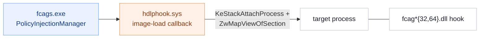

# The user-mode hooks, up close

The hooks are how Trellix DLP sees data **in use** — inside applications, while it is still
plaintext, before it is encrypted, printed, copied or uploaded. This is a focused,
**read-only static** teardown, companion to [`DRIVERS.md`](DRIVERS.md) (the injection
driver that places them) and [`FCAGS.md`](FCAGS.md) (the service that decides where).

*Method: version resources + file inventory + the service/driver evidence. Nothing run or
modified. All modules are signed by **Musarubra US LLC**.*

## How they get there

**[observed]** The service's `PolicyInjectionManager` and `CTDllInjection` policy type
decide which processes to hook; `hdlphook.sys` registers an image-load/process-create
callback and maps the hook DLL into the target (see `DRIVERS.md`); the log line
`Madshi driver installed` indicates the **madCodeHook** framework. **[observed]** Hooks
ship as 32- and 64-bit pairs so both bitnesses of a target can be covered.

## The hooks (by channel)

**[observed]** From each DLL's FileDescription (23 hook/plugin modules):

| Module(s) | Channel it watches |
|---|---|
| `fcagcbh32/64` | **Clipboard** — copy/paste of sensitive data |
| `fcagpph32/64` | **Printing** — local & network |
| `fcagsch32/64` | **Screen capture** — screenshots / screen share |
| `fcagcfh32/64` | **Copy / Save-as file** operations |
| `fcagclh32/64` | **Cloud** application uploads |
| `fcagmtph32/64` | **MTP** devices — phones, cameras, media players |
| `fcagafa32/64` | **Application file access** |
| `fcagchrome / chrome64` | **Chrome/Chromium** content |
| `fcagff / ff64` | **Firefox** content |
| `fcagiep32/64`, `fcplie32/64` | **Internet Explorer / Edge** content |
| `fcagolh32/64` | **Outlook** (see [`EMAIL.md`](EMAIL.md)) |

## Why both hooks *and* drivers

**[inferred]** Hooks see **semantics** (this is an upload to site X, this is a paste into
app Y, this is a print job) that the kernel cannot easily reconstruct — but they live in
the target process and could be evaded. The kernel drivers (`DRIVERS.md`) provide the
guaranteed backstop. The two layers overlap on purpose: context from user mode, a hard
floor from the kernel.

## Not established

- **[unknown]** The exact API set each hook intercepts and the hook↔service message
  schema (shared memory + pipes; see `FCAGS.md`).
- **[unknown]** The per-process selection logic inside `PolicyInjectionManager`.
