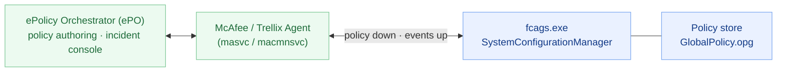

# The management plane (ePO), up close

The endpoint agent is normally one managed node in a fleet: a central server authors
policy and collects incidents, and a transport agent moves both. A **read-only static**
teardown, companion to [`FCAGS.md`](FCAGS.md).

*Method: the service's `SystemConfigurationManager`/discovery strings, registry state, and
the agent's own log. Nothing run or modified.*

## The pieces

## Policy distribution

**[observed]** `PolicyDispatcher` reads `GlobalPolicy.opg`; `IncrementalDataDistributionService`
handles incremental updates; the object model is `DLPProtocol` carried with
`boost::serialization` (see [`FCAGS.md`](FCAGS.md)). **[inferred]** ePO compiles a policy
and pushes it; the agent caches it as `GlobalPolicy.opg` and enforces it. **[unknown]** the
`.opg` container format (encrypted; not opened).

## Connectivity state machine

**[observed]** `SystemConfigurationManager` + `CheckConnectivity` run an ePO connectivity
loop; strings include `TestConnectivityByEPO`, `ReportInDLPConsole`, `MatchedItemsInEpo`.
On the analyzed host the log repeats *"ePO connection information is missing"* every ~30 s
and the registry has no `AgentGUID` (`AgentOnline=0`). **[inferred]** When unmanaged the
agent keeps retrying and enforces only locally-cached policy.

## Incidents, evidence & discovery

**[observed]** `CFileReplicatorService` (evidence copies); discovery config names
`ScanRepositories`, `Repositories`/`RepositoriesType`, `DiscoverySummaryReport`,
`SharePointServerURL`, `MSWord/Excel/PPTSharepointHandlerConfiguration`,
`MaxReportedIncidents`, `NumberOfReportedIncidents`. **[inferred]** Incidents and evidence
flow up to the console; at-rest **discovery** can scan file shares and SharePoint
repositories in addition to local files/mail.

## Managed vs standalone

**[observed]** Managed requires an ePO `AgentGUID` and the McAfee/Trellix Agent transport
(`masvc`/`macmnsvc`), neither present here. **[inferred]** Standalone operation is
supported but loses central policy updates and incident collection — the mode this test
host is in.

## Not established

- **[unknown]** The `GlobalPolicy.opg` / incremental-data formats and the exact
  agent↔ePO protocol.
- **[unknown]** Cloud vs on-prem reporting destinations and their authentication.
