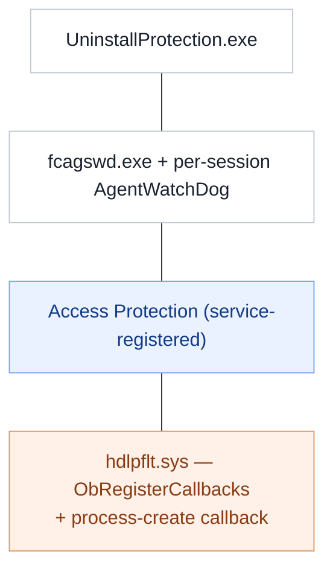

# Self-protection, up close

A security control is only as good as its resistance to being switched off, so the agent
defends its own availability and integrity at several layers. A **read-only static**
teardown of those mechanisms, companion to [`FCAGS.md`](FCAGS.md) and
[`DRIVERS.md`](DRIVERS.md).

*Method: file inventory, version resources, imports and the agent's own log. Nothing run
or modified.*

## The layers

## Availability — watchdogs

**[observed]** `fcagswd.exe` ("Trellix DLP Endpoint Service WatchDog") and a per-session
`AgentWatchDog` thread inside the service (log: *"Start WatchDog thread for session id"*).
**[inferred]** If the agent process stops, a watchdog restarts it, so simply killing a
process does not leave the endpoint unprotected for long.

## Integrity — Access Protection

**[observed]** The service enables an Access Protection object at startup (log:
*"enableDisableAccessProtection … AccessProtectionObject OK!"*). **[inferred]** This
registers protection of the agent's own resources so they cannot be trivially altered
while it runs.

## Kernel-backed protection

**[observed]** `hdlpflt.sys` imports `ObRegisterCallbacks` (object/handle callbacks) and
`PsSetCreateProcessNotifyRoutine` (see [`DRIVERS.md`](DRIVERS.md)). **[inferred]** Handle
callbacks let the driver strip dangerous access rights (e.g. terminate) from handles other
processes try to open to the protected processes — the kernel half of tamper resistance —
while the process callback tracks protected-process lifetime.

## Uninstall protection

**[observed]** `UninstallProtection.exe` (14 MB, signed). **[inferred]** Blocks
unauthorized removal of the agent so it cannot simply be uninstalled by a local user.

## Why it matters for this project

**[inferred]** These mechanisms are exactly why the tools in this repo (`dlpdump`,
`dlpaudit`) are **read-only** and why the analysis here is static: the right way to study a
self-protecting security agent is to observe it, not to fight its protection.

## Not established

- **[unknown]** The full set of resources Access Protection covers and the handle rights
  the driver strips.
- **[unknown]** How watchdog and Access Protection behave under an active managed policy
  versus the unmanaged state examined here.
